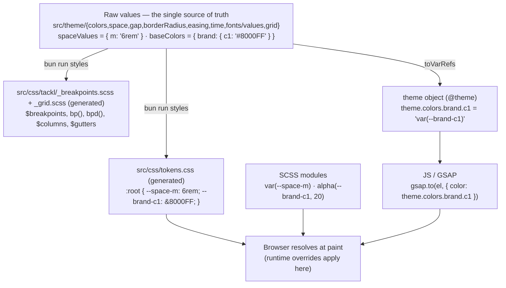

# Theming & Design Tokens

Tackl's tokens are defined once in TypeScript and generated once into CSS custom properties. SCSS modules, global styles, Server Components and JS (GSAP, inline styles) all read the same variables.

## How it works



- **`src/theme/**`** holds the raw values: `colors`, `space`, `gap`, `borderRadius`, `easing`, `time`, `fonts/values.ts` (font stacks + weights) and `grid` (breakpoints, columns, gutters, max width, design widths).
- **`scripts/build-styles.ts`** (`bun run styles`) generates from them:
  - `src/css/tokens.css` — every token as a custom property on `:root`
  - `src/css/tackl/_breakpoints.scss` — the `$breakpoints` map and the `bp()` / `bpd()` mixins
  - `src/css/tackl/_grid.scss` — `$columns`, `$gutters`, `$grid-max`, `$design-widths`
- **`app/(site)/layout.tsx`** imports `@css/tokens.css`, then `@css/global.scss`. Storybook's `preview.js` imports the same two files, so stories resolve tokens exactly like the app.

Generated files are committed — **never edit them by hand**. `bun run styles` runs automatically before `dev`, `build` and `storybook`, and the pre-commit hook runs `bun run styles --check`, which fails if a generated file is stale.

## Variable naming

| Section | Pattern | Tokens |
| --- | --- | --- |
| Colors | `--{group}-{name}` | `--brand-c1` … `--brand-c5`, `--global-white`, `--global-black`, `--feedback-positive`, `--feedback-negative`, `--feedback-warning` |
| Space | `--space-{key}` | `--space-s`, `--space-m`, `--space-l`, `--space-xl`, `--space-col` |
| Gap | `--gap-{key}` | `--gap-xxs`, `-xs`, `-s`, `-sm`, `-m`, `-l`, `-xl`, `-xxl`, `-huge`, `-uber` |
| Border radius | `--br-{key}` | `--br-xs`, `--br-s`, `--br-m`, `--br-l`, `--br-round` |
| Easing | `--easing-{key}` | `--easing-bezzy`, `--easing-bezzy2`, `--easing-bezzy3` |
| Time | `--time-{key}` | `--time-s`, `--time-m`, `--time-l` |
| Font stacks | `--font-{key}` | `--font-heading`, `--font-body`, `--font-mono`, `--font-script` |
| Font weights | `--weight-{key}` | `--weight-light`, `-regular`, `-medium`, `-semi`, `-bold`, `-heavy`, `-black` |

Stylelint checks every `var(--…)` in `.scss` files against `tokens.css`, so a typo like `var(--brand-c7)` fails `bun run lint`.

## Using tokens

### In SCSS

Read tokens with `var()` anywhere CSS is written — modules, `global.scss`, Server or Client Components alike:

```scss
.card {
	padding: var(--gap-l);
	background: var(--brand-c3);
	border-radius: var(--br-m);
	font-family: var(--font-heading);
	font-weight: var(--weight-medium);
	transition: transform var(--time-m) var(--easing-bezzy);
}
```

### In JS

`theme` (from `@theme`) mirrors the tokens as `var()` references, for code that needs a token as a string — GSAP tweens, inline styles, logic:

```tsx
import { theme } from '@theme';

theme.colors.brand.c1   // 'var(--brand-c1)'
theme.space.m           // 'var(--space-m)'

gsap.to(el, { color: theme.colors.brand.c1 });
```

Because the values are `var()` references, the browser resolves them — JS-driven styles follow runtime theme overrides too. `theme.font.weight` and `theme.grid` are the exceptions: they hold literal values (see [below](#what-is-not-a-runtime-variable)).

### Opacity — `alpha()` and `alpha()`

Color tokens are single values; opacity is applied at the point of use with `color-mix()`. There's a twin helper on each side:

```scss
// SCSS (injected — no import)
background: alpha(--brand-c1, 20);
border-color: alpha(#ffffff, 15);
```

```tsx
// JS
import { alpha } from '@tackl';

gsap.to(el, { backgroundColor: alpha('--brand-c1', 20) });
<div style={{ borderColor: alpha(theme.colors.global.white, 15) }} />
```

Both emit the same CSS:

```
alpha(--brand-c1, 20)   →  color-mix(in srgb, var(--brand-c1) 20%, transparent)
alpha('--brand-c1', 20) → color-mix(in srgb, var(--brand-c1) 20%, transparent)
```

They accept a token name (`--brand-c1`) or any colour value (`alpha()` also takes a theme token, which is already a `var()` reference). Opacity is clamped to 0–100; at 100 the colour is returned unchanged. The browser does the mixing, so translucent colours follow runtime overrides. The SCSS and JS helpers share the name `alpha` and the same arguments. (The SCSS one replaces Sass's legacy global `alpha($color)`; use `color.channel()` from `sass:color` if you ever need to read a colour's alpha channel.)

## Runtime theming

Redefine variables under a selector and every consumer — SCSS and JS — follows. No JS theming layer, no re-render:

```scss
// src/css/global.scss
html[data-theme='dark'] {
	--global-white: #000000;
	--global-black: #ffffff;
	--brand-c1: #9b30ff;
}
```

Toggle by stamping the attribute (e.g. `document.documentElement.dataset.theme = 'dark'`, or server-side on the `<html>` tag to avoid a flash). The same mechanism handles multi-brand / white-label builds: one attribute value per brand, one block of overrides each.

## Adding or changing a token

1. Edit the raw values in the token's file — e.g. `spaceValues` in `src/theme/space/index.ts`, `baseColors` in `src/theme/colors/index.ts`, `fontFamilies` / `fontWeights` in `src/theme/fonts/values.ts`.
2. Run `bun run styles` (or just restart `bun run dev`, which runs it first).

The `:root` declaration, the `theme` reference and the TypeScript types all derive from that one object, so nothing else needs updating.

## Breakpoints

Breakpoints live in `src/theme/grid/index.ts`: `s` 320, `sm` 390, `m` 700, `l` 1024, `xl` 1200, `xxl` 1400, `huge` 1600, `uber` 1800 (px). Styling is mobile-first.

**SCSS** — the generated mixins, injected into every `.scss` file:

```scss
.jacket {
	flex-direction: column;

	@include bp(m) {
		flex-direction: row; // (min-width: 700px)
	}

	@include bpd(m) {
		gap: var(--gap-s); // (max-width: 699.98px) — the rare max-width case
	}
}
```

**JS** — from `@tackl`, generated from the same values:

```ts
import { breakpoints, mq } from '@tackl';

breakpoints.m  // '700px'
mq.up.m        // '(min-width: 700px)'
mq.down.m      // '(max-width: 699.98px)'

gsap.matchMedia().add(mq.up.l, () => { /* desktop-only tweens */ });
```

`bpd` / `mq.down` sit 0.02px under the breakpoint so up and down never both match. `useAnimation`'s default conditions (`isMobile` / `isTablet` / `isDesktop`) are built from `mq`, and `useResponsive` uses `breakpoints.l`. Add a breakpoint to the grid tokens, run `bun run styles`, and `bp()`, `mq`, and the [span props](./GridSystemProps.md) all pick it up.

## Cascade layers

`src/css/global.scss` declares the layer order up front:

```scss
@layer reset, base, grid, utilities;
```

| Layer | Contains |
| --- | --- |
| `reset` | Margin/padding reset, list/link/form resets, hidden scrollbars |
| `base` | `html` / `body`, focus rings, Lenis wrapper, reduced-motion fallback, view transitions |
| `grid` | `waffl-grid` and its span cascade |
| `utilities` | `[data-pad]` / `[data-mar]`, `.t-*` / `[data-type]` |

Component modules are **unlayered**, and unlayered styles beat every layer — so a module rule always wins over resets, grid defaults and utilities, with no specificity games or `!important`.

## What is NOT a runtime variable

- **Breakpoints & grid** (`theme.grid`) — media queries can't read CSS variables, so these are build-time tokens, delivered as SCSS mixins/maps and the JS `breakpoints` / `mq`. Changing them means `bun run styles` and a rebuild, not a runtime override.
- **`theme.font.weight`** — literal numbers in JS (handy as animation targets). In CSS use the `--weight-*` variables.
- **Design widths** (`theme.grid.design`) — numbers used for `vw()` / `getVw()` maths.
