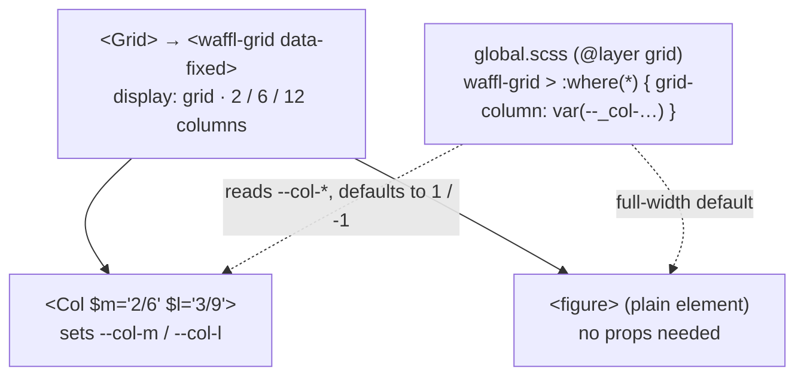

# Waffl Grid

Waffl is Tackl's responsive column grid: a server-rendered `<waffl-grid>` element styled entirely from `src/css/global.scss`, plus [`<Col>`](./SemanticComponents.md) for children that need a narrower span.

## Overview

```tsx
import { Col } from '@tackl';
import Grid from '@waffl';

<Grid $isFixed>
	<Col as='article' $m='2/6' $l='3/9'>Narrower on larger screens</Col>
	<figure>Full width by default — no props, no component</figure>
</Grid>
```

- **`Grid`** (default export of `@waffl`) renders a plain `<waffl-grid>` tag. There is no JavaScript custom element, no shadow DOM and no client code — it's a Server Component.
- **Every direct child spans the full width** unless told otherwise.
- **`Col`** (from `@tackl`) narrows a child per breakpoint via span props.



## Columns, gutters, max width

| Breakpoint | From | Columns | Gutter | Side margin |
| --- | --- | --- | --- | --- |
| `s` (base) | 0px | 2 | 2.4rem | 2.4rem |
| `m` | 700px | 6 | 2.4rem | half a gutter |
| `l` | 1024px | 12 | 3.6rem | half a gutter |

Breakpoints `sm`, `xl`, `xxl`, `huge` and `uber` keep the column count of the step below them (2 or 12) but can still carry their own spans. The values come from `src/theme/grid/index.ts` (`columns`, `gutter`, `maxSize`, `breakpoints`), generated into `src/css/tackl/_grid.scss` and `_breakpoints.scss` by `bun run styles` — change them there, never in the generated files.

The grid exposes its current layout as custom properties on the element — `--grid-columns`, `--grid-gutter`, `--grid-margin` — which you can read inside it (e.g. `gap: var(--grid-gutter)` on a nested flex row).

## Grid props

Boolean props become data attributes on the `<waffl-grid>`:

| Prop | Attribute | Effect |
| --- | --- | --- |
| `$isFixed` | `data-fixed` | `max-width: 1440px` (the `maxSize` token), centred |
| `$noGutter` | `data-no-gutter` | `column-gap: 0` |
| `$noMargin` | `data-no-margin` | `padding-inline: 0` — no side margins |
| `$isFullscreen` | `data-fullscreen` | `height: 100%` |
| `$isCenter` | `data-center` | `place-items: center` |

```tsx
<Grid $isFixed $noGutter>…</Grid>
// → <waffl-grid data-fixed data-no-gutter>…</waffl-grid>
```

`Grid` also accepts the span props (`$s` … `$uber`) so it can sit inside another grid, plus any HTML attribute (`className`, `id`, `data-pad`, `aria-*`…). Its `className` is where you add component-specific layout, e.g. `row-gap`.

## Full-width by default

`global.scss` gives every direct child of a grid a default span with a zero-specificity selector:

```scss
waffl-grid > :where(*) {
	grid-column: var(--_col-s); // resolves to 1 / -1 when no span is set
	/* …one bp() step per breakpoint */
}
```

Because `:where()` adds no specificity, plain elements, module-styled elements and Server Components are all first-class grid children with nothing to opt into. Only add a `Col` (or spans) to children that need to be narrower. Avoid setting `grid-column` in a child's module class unless you mean to override the span system for that element — an unlayered module rule beats the `grid` layer.

## Spans and the fallback cascade

A span is a `grid-column` value set per breakpoint: `$m='2/6'` means "from 700px up, start at line 2 and end at line 6". Each breakpoint falls back to the one below it, and the base falls back to full width:

```
s   → --col-s,   else 1 / -1
sm  → --col-sm,  else whatever s resolved to
m   → --col-m,   else whatever sm resolved to
l   → --col-l,   else whatever m resolved to
…up to uber
```

So you only set the breakpoints where the layout changes:

```tsx
<Col $l='3/11'>…</Col>                 {/* full width below 1024px, cols 3–10 from l up */}
<Col $m='1/4' $l='1/7'>…</Col>         {/* full on mobile, half on tablet, half on desktop */}
<Col $m='2/6' $xl='4/10'>…</Col>       {/* l inherits m's 2/6 until xl */}
```

Values, syntax and more examples: [Grid span props](./GridSystemProps.md).

## Nested grids

A grid can be a child of another grid — give the inner `Grid` span props like any other child:

```tsx
<Grid $isFixed>
	<Grid $l='2/12' $noMargin>
		<Col $l='1/6'>…</Col>
		<Col $l='6/11'>…</Col>
	</Grid>
</Grid>
```

The inner grid builds its own column tracks (2 / 6 / 12) inside the area it spans; `$noMargin` drops its side padding so it lines up with the outer content.

Spans never leak between levels. The `--col-*` properties are registered with `@property … { inherits: false }`, and each `waffl-grid` also resets them to `initial` (for browsers without `@property`). A nested grid's children start from full width, whatever the parent's spans were.

## Setting spans by hand

`Col` only sets custom properties, so any element can do the same through `style` — useful when the element is already another component or you don't want a wrapper:

```tsx
<Link href='/work' style={{ '--col-m': '2/6', '--col-l': '3/9' }}>…</Link>
```

Or in a module, on a direct child of a grid:

```scss
.media {
	--col-m: 1/4;
	--col-l: 7/13;
}
```

`style` accepts `--*` keys with full typing (`src/types/css.d.ts`), so no casts are needed.

## Debugging

- **`GridExposer`** (`src/components/GridExposer`) overlays the column tracks — `Ctrl + G` toggles it, `Ctrl + F` switches its colour scheme. It reads the same grid tokens, so the overlay always matches.
- In DevTools, check the child's `--col-*` values and the resolved `grid-column`. If a span isn't applying, confirm the element is a **direct** child of the `<waffl-grid>` — spans only work one level down.

## Best practices

- Let children default to full width; don't write `$s='1/-1'` everywhere.
- Set spans only where the layout changes and let the cascade fill in the rest.
- Use `$isFixed` on page-level grids to cap the content width.
- Prefer a nested `Grid` over hand-maths when a section needs its own sub-columns.
- Change column counts, gutters and breakpoints in `src/theme/grid/index.ts`, then run `bun run styles`.
