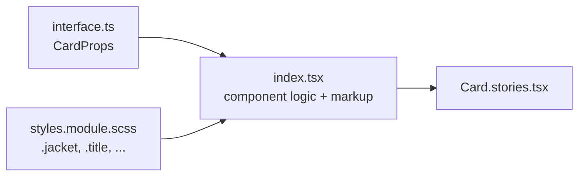

# Writing Components — The Tackl House Style

How components are structured, commented, and wired into the tokens and grid. Follow this and every component in the project reads the same way.

## Component anatomy

Every component lives in its own folder under `src/components/`:

```
src/components/Card/
├── index.tsx            # The component — logic and markup only
├── styles.module.scss   # ALL styles for this component (a CSS Module)
├── interface.ts         # The component's prop types
└── Card.stories.tsx     # Storybook story (optional)
```



Rules:

- **Styles live in `styles.module.scss`**, imported as `import s from './styles.module.scss'`. No inline style objects for static styling, no global classes invented per component.
- **The outermost class is always `.jacket`.** Inner classes get descriptive camelCase names (`.title`, `.content`, `.removeButton`) so they read as `s.title`, `s.removeButton`.
- **Tags are written in JSX.** `<section className={s.jacket}>` — the markup says what the element is.
- **Props are typed in `interface.ts`**, imported as `import type * as I from './interface'`.
- **`'use client'` only when the component needs it** (hooks, event handlers, browser APIs). Styling never requires it — a Server Component can be styled with a module directly.

## The comment style

Files are organised with titled blocks, each underlined with 12 dashes — every file, same order:

```tsx
'use client'; // only when needed

// Imports
// ------------

// Styles + Interfaces
// ------------

// Component
// ------------

// Exports
// ------------
```

Inside the component body, prefix each logical group with a single-line label — only those that apply, never empty placeholders: `// Context`, `// Refs`, `// State`, `// Derived`, `// Handlers`, `// Effects`, `// Animations`, `// Render`. The `// ------------` underlines stay at file level, not inside the body.

Inline annotations use bullet markers:

- `// SECTION •` — a region of related code
- `// NOTE •` — a constraint or behaviour the code can't show on its own
- `// ANCHOR •` — an important function or entry point
- `// REVIEW —` — usage example worth reading

The same markers work in `.scss` files (`// SECTION • Hover state`).

## A complete component

**`src/components/Card/interface.ts`**

```tsx
// Exports
// ------------
export interface CardProps {
	title: string;
	body: string;
	isActive?: boolean;
	className?: string;
}
```

**`src/components/Card/styles.module.scss`**

```scss
.jacket {
	display: flex;
	flex-direction: column;
	gap: var(--gap-m);
	padding: var(--gap-l);

	background: fade(--brand-c3, 40);
	border-radius: var(--br-m);
	transition: background var(--time-m) var(--easing-bezzy);

	&:hover,
	&[data-state='active'] {
		background: var(--brand-c3);
	}

	@include bp(l) {
		padding: var(--gap-xl);
	}
}

.title {
	@include titleS;
}

.body {
	@include bodyS;
	color: fade(--global-white, 80);
}
```

**`src/components/Card/index.tsx`**

```tsx
// Imports
// ------------
import { cx } from '@utils/cx';

// Styles + Interfaces
// ------------
import type * as I from './interface';
import s from './styles.module.scss';

// Component
// ------------
const Card = ({ title, body, isActive, className }: I.CardProps) => {
	// Render
	return (
		<article className={cx(s.jacket, className)} data-state={isActive ? 'active' : undefined}>
			<h3 className={s.title}>{title}</h3>
			<p className={s.body}>{body}</p>
		</article>
	);
};

// Exports
// ------------
Card.displayName = 'Card';
export default Card;
```

## Styling with modules

- **Tokens are CSS variables** — `var(--brand-c1)`, `var(--gap-l)`, `var(--time-m)`, `var(--easing-bezzy)`. Never hard-code hex values or durations. The full list and how they're generated is in [Theming](./Theming.md).
- **Nesting under a local class is fine** (`.jacket p { … }`, `.jacket:hover .title { … }`). Bare tag selectors at the top level of a module are not allowed (CSS Modules pure mode) — anything genuinely global belongs in `src/css/global.scss`.
- **Modules always win.** Global styles sit in cascade layers (`reset`, `base`, `grid`, `utilities`); component modules are unlayered, so a module rule beats any of them without specificity games or `!important`.

### The injected SCSS layer

Every `.scss` file gets `@use 'tackl' as *;` prepended automatically (`sassOptions.additionalData` in `next.config.js`), so the following are available in any module **with no imports**:

| Helper | Kind | Example |
| --- | --- | --- |
| `bp($key)` | mixin — `min-width` query | `@include bp(m) { … }` |
| `bpd($key)` | mixin — `max-width` query (rare) | `@include bpd(m) { … }` |
| `fade($color, $opacity)` | function — translucent colour | `background: fade(--brand-c1, 20);` |
| `vw($px, $design: desktop)` | function — px → vw against a design width | `font-size: vw(48);` `margin: vw(24, mobile);` |
| `pad($side)` / `mar($side)` | mixins — section spacing | `@include pad;` `@include mar(bottom);` |
| `noscrollbars` | mixin — hide scrollbars, keep scrolling | `@include noscrollbars;` |
| Type mixins | mixins — text styles | `@include headlineL;` |
| `$breakpoints`, `$columns`, `$gutters`, `$grid-max`, `$design-widths` | maps / values | `map.get($columns, l)` |

The layer lives in `src/css/tackl/` and emits zero CSS on its own — it's mixins, functions and variables only. If an editor needs it for IntelliSense, adding `@use 'tackl' as *;` at the top of a file is harmless.

### Breakpoints — mobile-first

Base styles **are** the mobile styles; `bp()` layers changes on top as the viewport grows.

| Key | `bp()` fires at | Grid columns |
| --- | --- | --- |
| `s` | ≥ 320px | 2 |
| `sm` | ≥ 390px | 2 |
| `m` | ≥ 700px | 6 |
| `l` | ≥ 1024px | 12 |
| `xl` | ≥ 1200px | 12 |
| `xxl` | ≥ 1400px | 12 |
| `huge` | ≥ 1600px | 12 |
| `uber` | ≥ 1800px | 12 |

```scss
.jacket {
	// Mobile — no wrapper needed
	flex-direction: column;
	gap: var(--gap-m);

	@include bp(m) {
		flex-direction: row; // ≥ 700px
	}

	@include bp(l) {
		gap: var(--gap-xl); // ≥ 1024px
	}
}
```

`bpd(m)` is the `max-width` counterpart (`max-width: 699.98px`, so `bp` and `bpd` never overlap at the boundary). Reach for it sparingly — if you use it often, the base styles are probably desktop-first. For breakpoints in JS (`breakpoints`, `mq`), see [Theming](./Theming.md#breakpoints).

### Type

Type styles are hand-written mixins in `src/css/tackl/_type.scss`: `displayL`, `displayS`, `headlineL`, `headlineS`, `titleL`, `titleS`, `bodyL`, `bodyS`, `captionL`, `captionS`. Each one is available three ways:

```scss
// 1. Mixin, inside a module
.title {
	@include headlineL;
}
```

```tsx
// 2. Global class
<h2 className='t-headlineL'>…</h2>

// 3. Data attribute
<p data-type='captionL'>…</p>
```

Use the mixin when the element already has a module class; use the class or attribute for one-off text that doesn't need its own rule. To add a style, write the mixin in `_type.scss`, then add its name to the `$type-styles` list at the bottom of that file — the `.t-*` class and `data-type` selector are generated from that list.

### Spacing

Section spacing comes from the `--space-*` tokens and steps up responsively: `--space-s` on mobile, `--space-m` from `bp(m)`, `--space-l` from `bp(l)`. Apply it from the HTML or from a module:

```tsx
<section data-pad>…</section>              // padding top + bottom
<section data-pad='top'>…</section>        // padding top only
<div data-mar='top bottom'>…</div>         // values combine
```

```scss
.jacket {
	@include pad;          // top + bottom
	@include mar(bottom);  // margin-bottom only
}
```

Sides are `block` (the default — top and bottom), `top` and `bottom`. More in [Col & spacing attributes](./SemanticComponents.md).

### State → data attributes, values → custom properties

Dynamic **state** goes on a `data-*` attribute and is styled with an attribute selector; dynamic **values** go in a CSS custom property via `style`.

```tsx
<div className={s.jacket} data-state={isOpen ? 'open' : 'closed'} style={{ '--progress': progress }}>
```

```scss
.jacket {
	transform: scaleX(var(--progress, 0));

	&[data-state='open'] {
		background: var(--brand-c1);
	}
}
```

`style` objects accept `--*` keys with full typing (`src/types/css.d.ts`), so no casts are needed.

### Combining classes with `cx()`

`cx()` from `@utils/cx` joins class names and skips falsy values — use it to combine module classes, global utility classes and an optional `className` prop:

```tsx
import { cx } from '@utils/cx';

<h2 className={cx(s.title, 't-headlineL', isActive && s.active, className)} />
```

Prefer a `data-*` attribute over a conditional class when the change is a state of the same element.

## Using the grid

`Grid` (from `@waffl`) renders a plain `<waffl-grid>`. Every direct child spans the full width by default; reach for `<Col>` (from `@tackl`) only when a child needs a narrower span:

```tsx
import { Col } from '@tackl';
import Grid from '@waffl';

<Grid $isFixed>
	{/* full on mobile, cols 2–6 of 6 on tablet, cols 3–9 of 12 on desktop */}
	<Col as='article' className={s.content} $m='2/6' $l='3/9'>…</Col>

	{/* full width at every breakpoint — no props, no component */}
	<figure className={s.media}>…</figure>
</Grid>
```

Each span falls back to the breakpoint below it, so `$l` alone stays full-width below `l`. Details in [Waffl Grid](./WafflGrid.md) and [Grid span props](./GridSystemProps.md).

## Import cheat sheet

| Import | Gives you | Use for |
| --- | --- | --- |
| `./styles.module.scss` | `s` — the module's class names | Every component's styles |
| `@tackl` | `Col`, `breakpoints`, `mq`, `alpha`, `getVw`, `getVwTablet`, `getVwMobile` | Grid children, breakpoints and colour/viewport helpers in JS |
| `@waffl` | `Grid` (default export) | The grid container |
| `@theme` | `theme` — tokens as `var()` references | JS that needs a token (GSAP, inline styles) |
| `@utils/cx` | `cx` | Joining class names |
| `@utils/*` | `src/utils/*` | Hooks and helpers |
| `@parts/*` | `src/components/*` | Other components |
| `@cms` | `fetchContent`, query strings | Data fetching (adapter-agnostic — see docs/CMS.md) |
| `@css/*`, `@public/*` | Global stylesheets, static assets | |

## Do / Don't

| ✅ Do | ❌ Don't |
| --- | --- |
| `<section className={s.jacket} data-pad>` | Wrap tags in a component just to pick the element |
| Name the outermost class `.jacket`, camelCase the rest | Kebab-case classes you then have to read as `s['remove-button']` |
| Base styles = mobile, `@include bp(m)` upwards | Desktop styles first, `bpd()` everywhere |
| `var(--brand-c1)` | Hard-coded hex values |
| `fade(--brand-c1, 20)` for translucency | Hand-rolled rgba strings |
| `transition: x var(--time-m) var(--easing-bezzy)` | Magic duration numbers |
| `&[data-state='open']` for state | Toggling one-off global classes |
| Let grid children default to full width | `<Col $s='1/-1'>` on everything |
| Bare tag selectors in `global.scss` | Bare tag selectors at the top level of a module |
